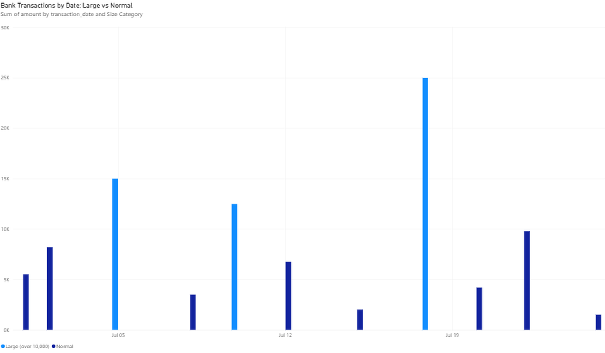

# SQL-Powered Bank Reconciliation Engine

A bank reconciliation tool built on a proper database foundation — Python talking directly to SQL, instead of processing flat CSV files. Built while learning SQL from first principles against real transaction data, then engineered into a reusable tool.

## What It Does

Given a SQLite database with `bank_statement` and `ledger` tables, this tool:

- **Matches transactions** between bank and ledger by amount, within a configurable date window (accounts for the real-world lag between when something is recorded and when it clears)
- **Flags unmatched bank items** — things the bank shows that haven't been recorded in the ledger
- **Flags unmatched ledger items** — things recorded in the ledger that haven't cleared the bank yet
- **Exports a full Excel report** with matched, unmatched, and summary sheets

## The Interesting Part: A Real Bug, Found and Fixed

A naive SQL `JOIN` on amount alone causes a classic **fan-out problem** — one bank transaction can match multiple ledger entries that happen to share the same amount, silently inflating your match count. This project handles it explicitly:

```python
# Keep the closest-date match per bank transaction, drop the rest (de-fan-out)
df = df.sort_values("date_gap_days").drop_duplicates(subset="bank_txn_id", keep="first")
```

This was discovered by cross-checking `COUNT(*)` against `COUNT(DISTINCT bank_txn_id)` on real data — a good example of why verifying join results matters, not just trusting the row count on screen.

## Included: Full SQL Course

`SQL_Complete_Lesson_Course.sql` is a self-contained, 14-lesson SQL course — every query tested and verified against a real database before inclusion. Covers `SELECT`/`WHERE`/`ORDER BY`, aggregates, `GROUP BY`, `JOIN` and `LEFT JOIN` (including the fan-out trap above), `CASE WHEN`, subqueries, `UNION ALL`, views, and window functions.

## Run It

```bash
pip install pandas
python sql_reconciliation_engine.py
```

Requires a SQLite database (`bank_reconciliation.db` by default) with `bank_statement` and `ledger` tables. A sample database (`sample_bank_reconciliation.db`) with realistic but fully synthetic data is included so you can run this immediately without any setup.

**Note:** The included sample database uses randomly generated placeholder vendors, payers, and amounts — no real financial data is published in this repository.

## Tech Stack

- **Python** (`sqlite3`, `pandas`) — query execution and report generation
- **SQLite** — lightweight, file-based database, ideal for this scale of reconciliation work
- **Excel export** via `openpyxl`

## Related Projects

This is a database-backed evolution of the Bank Reconciliation Automator in [credit-control-automation](https://github.com/denis-sean/credit-control-automation), which works directly from CSV exports. Use this version when the source data lives in — or can be loaded into — a real database.

## Author

Denis Odhiambo — Finance professional building Python + SQL tools for financial automation and reconciliation.

**Links:** [GitHub](https://github.com/denis-sean) | [LinkedIn](https://linkedin.com/in/denis6285) | [Email](mailto:denisodhiambo.6285@gmail.com)

## Excel Automation & Power BI (Power Query, VBA, DAX)

The same bank-reconciliation problem, solved with Excel and Power BI tools. Sample data only; no real financial data is included.

| Step | Tool | What it does |
|---|---|---|
| 1 | **Power Query** | Merges the bank statement and the internal ledger (Left Outer join on amount and date) and filters to unmatched rows. |
| 2 | **VBA** | `HighlightLargeTransactions` loops through the bank statement and flags any amount over 10,000 in bold red. A button on the sheet runs it. See `HighlightLargeTransactions.bas`. |
| 3 | **Power BI + DAX** | Column chart of bank transactions by date, coloured by a calculated column: `Size Category = IF(bank_statement[amount] > 10000, "Large (over 10,000)", "Normal")`. |



Skills shown: Power Query merges, VBA loops and conditionals, DAX calculated columns, Power BI visuals.
